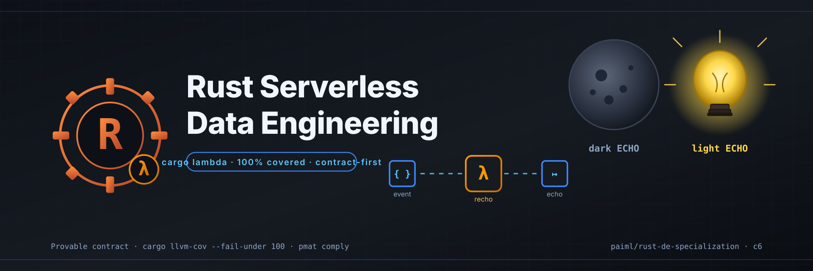

# Rust Serverless Data Engineering

<p align="center">
  
</p>

<p align="center">
  <a href="https://github.com/paiml/rust-serverless-data-engineering/actions/workflows/ci.yml"></a>
  <a href="#license"></a>
  <a href="https://github.com/paiml/rust-de-specialization"></a>
  
</p>

Companion repo for **Course 6 of the [Rust for Data Engineering Coursera specialization](https://github.com/paiml/rust-de-specialization)**. The headline crate is `recho/` — a `cargo lambda`-deployable echo handler that demonstrates idempotent, contract-checked serverless data pipelines in Rust. Side-by-side ports in `scripting-demos/` (Python, JavaScript, Ruby) show the same handler shape across languages so students can compare ergonomics, performance, and failure modes.

## Provable contract

For every payload `e` accepted by `recho::function_handler(e, rng)`:

1. `e.payload.message == Some(m)` and `m.trim().to_lowercase() == "echo"` →
   `Ok(Response { message })` with `message ∈ {"🌑 dark ECHO", "💡 light ECHO"}`, chosen
   deterministically from `rng`.
2. `e.payload.message == Some(m)` and the normalized form is not `"echo"` →
   `Ok(Response { message: format!("You said: {}. Say 'echo' to play the tunnel game!", normalized) })`.
3. `e.payload.message == None` →
   `Err(_)` whose `Display` contains the literal substring `Missing 'message' field`.

Every clause is exercised on every push by the CI coverage gate
(`cargo llvm-cov --fail-under-{lines,functions,regions} 100` on `recho/src/lib.rs`).

## Install

You need a recent stable Rust toolchain (MSRV 1.75) and `cargo-lambda` for deployment.

```bash
# Toolchain
rustup toolchain install stable
rustup component add rustfmt clippy llvm-tools-preview

# cargo-lambda for deploying to AWS Lambda
cargo install cargo-lambda

# Coverage tooling
cargo install cargo-llvm-cov

# Clone
git clone https://github.com/paiml/rust-serverless-data-engineering
cd rust-serverless-data-engineering
```

## Usage

```bash
# Build, test, and run the 100% coverage gate (matches CI)
cd recho
cargo fmt --check
cargo clippy --all-targets --all-features -- -D warnings
cargo test --all-features
cargo llvm-cov --all-features \
  --ignore-filename-regex 'main\.rs' \
  --fail-under-lines 100 \
  --fail-under-functions 100 \
  --fail-under-regions 100 \
  --summary-only

# Deploy to AWS Lambda
cargo lambda build --release
cargo lambda deploy

# Invoke via the included shell wrapper
../tunnel.sh "echo"        # dark or light ECHO
../tunnel.sh "hello"       # tunnel-game prompt
```

## Layout

| Path | What |
|------|------|
| `recho/` | The Rust workspace member. `lib.rs` holds all logic and is gated at 100% coverage; `main.rs` is a 9-line `tokio::main` shim that wires the handler into `lambda_runtime::run`. |
| `scripting-demos/tunnel.{js,py,rb}` | Side-by-side ports of the same handler shape — pedagogy, not production. |
| `tunnel.sh` | `cargo lambda invoke` wrapper for the deployed handler. |
| `docs/hero.svg` | The hand-authored hero banner above. |
| `.github/workflows/ci.yml` | Build + clippy + test + 100% coverage gate. |
| `CLAUDE.md` | Agent collaboration contract — read before editing. |

## Companion to

- **Specialization umbrella:** [paiml/rust-de-specialization](https://github.com/paiml/rust-de-specialization)
- **Course catalog (course-studio):** [paiml/course-studio](https://github.com/paiml/course-studio)
- **Course slot:** c6 — Rust Serverless Data Engineering (replaces "DuckDB with Rust")

## License

[AGPL-3.0-or-later](https://spdx.org/licenses/AGPL-3.0-or-later.html). See the
[`LICENSE`](LICENSE) file for the full text.
